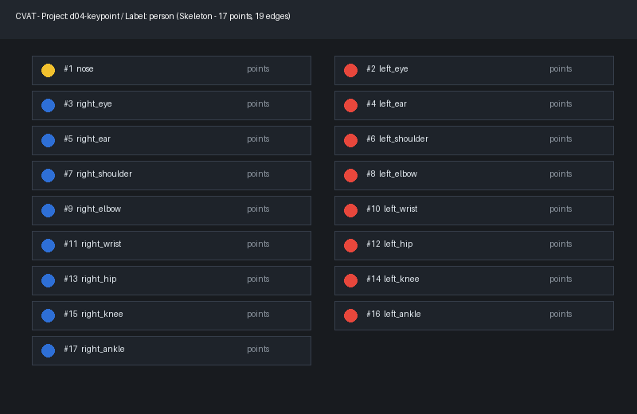
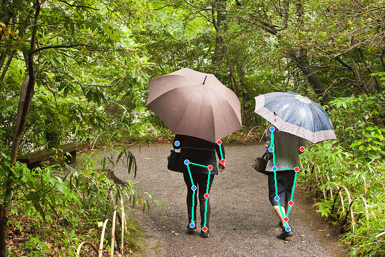
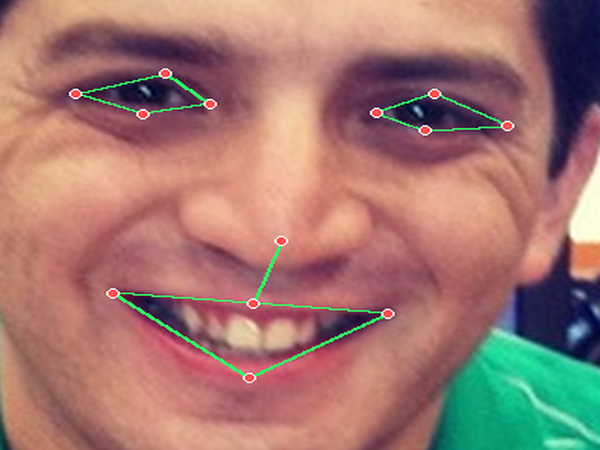
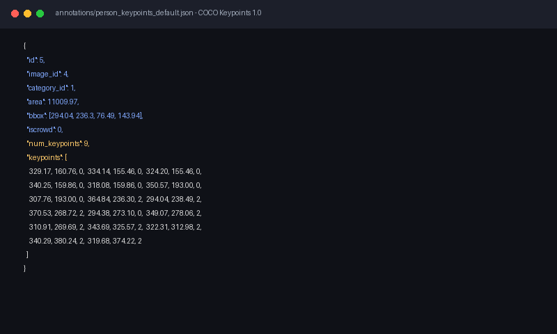

# Báo cáo cá nhân — NguyenTrongHung-2A202603147

Đổi tên file theo quy tắc `MSSV_HoTen.md`: `2A202603147_NguyenTrongHung.md`.

Dữ liệu: 12 ảnh người COCO val2017 (Lin et al., 2014) và 8 ảnh chân dung Wikimedia Commons, chỉ dùng trong lớp.

## 0. Thông tin học viên

- Họ tên: Nguyễn Trọng Hùng
- MSSV: 2A202603147
- Email: ngtronghung04@gmail.com
- Link repository: https://github.com/ngtronghung004-droid/K5-L2-DAY4-NguyenTrongHung-2A202603147-KeypointPose
- Phiên bản CVAT (Help → About): 2.74.1
- Máy: hệ điều hành Windows 11 · RAM 16 GB · chạy CVAT chế độ đầy đủ
- Bộ ảnh (`src/exports/assignment.json` do `lab.py setup` tạo): có
- Giờ bắt đầu: 17:00
- Giờ kết thúc: 21:00

## 1. Kiểm tra label (CP0)

| Label | Kiểu | Số điểm | Tên điểm đúng bảng của lab? | Đúng thứ tự? | Số cạnh |
|---|---|---:|---|---|---:|
| `person` | Skeleton | 17 | Có | Có | 19 |
| `face` | Skeleton | 13 | Có | Có | 13 |

Mẫu `person` dựng theo người quay mặt về camera (các điểm `left_*` nằm bên phải khung mẫu)? Có

Cách đổi cờ `occluded` / `outside` cho **một điểm** trên phiên bản CVAT này (một câu):
Rê chuột vào điểm cần đổi rồi nhấn phím `Q` để chuyển sang `occluded` ($v = 1$, hiển thị dạng vòng rỗng nét đứt), nhấn phím `O` để chuyển sang `outside` ($v = 0$, điểm biến mất khỏi khung nhìn), hoặc click chuột phải trực tiếp vào điểm để chọn trạng thái mong muốn trong menu ngữ cảnh.

## 2. Số lượng đã gán và thời gian (CP1, CP2)

| Nhóm ảnh | Số ảnh | Số skeleton đã gán | Số người dưới 60 px (không gán) | Số poster / gương / màn hình bỏ qua | Thời gian (phút) |
|---|---:|---:|---:|---:|---:|
| `easy` | 5 | 5 | 0 | 0 | 25 |
| `occluded` | 3 | 6 | 0 | 0 | 25 |
| `back` | 2 | 4 | 0 | 0 | 20 |
| `small` | 1 | 3 | 2 | 0 | 15 |
| `crowd` | 1 | 3 | 1 | 0 | 20 |
| `faces` | 8 | 8 | — | 0 | 25 |

- Số ảnh người đã xong ở mốc phút 105: 10 / 10
- Thời gian thực tế (phút): CP1 105 · CP2 25 · CP3 20
- Ảnh tốn thời gian nhất là ảnh nào, vì sao?
Ảnh nhóm `crowd` (`000000413160.jpg`) và nhóm `small` (`000000269462.jpg`) tốn nhiều thời gian nhất vì người trong ảnh đứng san sát nhau, nhiều đoạn chi bị người khác che khuất hoặc tự che khuất. Phải phóng to màn hình tối đa, lần theo từng đoạn xương (vai → khuỷu → cổ tay, hông → gối → cổ chân) để không gắn nhầm xương sang người đứng cạnh, đồng thời phải phán đoán đúng hướng đứng của từng người nhằm không bị đảo ngược trái/phải (`lr_swap`).

## 3. Bảng ca khó (CP1, CP2)

Mỗi điểm phân vân một dòng, nhất là phân vân giữa `v = 1` và `v = 0`, hoặc không chắc hướng người.

| Ảnh | Người / mặt | Điểm | Cờ đã chọn | Phân vân giữa | Lý do chọn |
|---|---|---|---:|---|---|
| `000000054909.jpg` | Người 1 (id 5) | `nose`, `left_eye`, `right_eye` | 0 | `v = 1` và `v = 0` | Người quay lưng hoàn toàn về phía camera, khuôn mặt hướng về phía trước bị che khuất 100% và không có cơ sở ước lượng chính xác từng pixel nên chọn `outside` ($v = 0$). |
| `000000030960.jpg` | Người 1 (id 3) | `left_knee`, `left_ankle` | 1 | `v = 1` và `v = 2` | Chân bị vật cản phía trước che mất một phần khớp, tuy nhiên thấy rõ đường đi của cẳng chân và đùi nên ước lượng chắc chắn vị trí khớp, chọn `occluded` ($v = 1$). |
| `000000351176.jpg` | Người 2 (id 9) | `left_wrist` | 0 | `v = 1` và `v = 0` | Cổ tay bị thân mình che khuất hoàn toàn, góc gấp khuỷu tay không rõ ràng nên không thể ước lượng chắc chắn, chọn `outside` ($v = 0$). |
| `face_301643.jpg` | Mặt kính râm | `left_eye_*`, `right_eye_*` | 1 | `v = 1` và `v = 0` | Mắt bị che bởi tròng kính râm tối màu, tuy nhiên có thể ước lượng chắc chắn vị trí mắt theo sống mũi và khung gọng kính nên đặt `occluded` ($v = 1$) theo đúng rubric C6. |
| `face_560526.jpg` | Mặt tóc che | `left_eye_*` | 0 | `v = 1` và `v = 0` | Tóc mái dày che phủ hoàn toàn mắt trái, không thấy gọng hay mí mắt, yêu cầu mí mắt cần chính xác từng pixel nên chọn `outside` ($v = 0$) để tránh làm lệch hàm OKS. |

## 4. Bảng tự review (CP3)

Đi từ ảnh cuối về ảnh đầu. 5 ảnh người (ít nhất 2 ảnh `back` hoặc `crowd`) và 3 ảnh mặt. Ít nhất 8 dòng, kể cả dòng `ok`. Ghi lỗi trước, sửa sau.

Mã lỗi dùng đúng một trong: `lr_swap`, `vis_flag`, `position`, `missing`, `extra`, `ok`.

| Ảnh | Người / mặt | Điểm | Mã lỗi | Ghi chú | Đã sửa? |
|---|---|---|---|---|---|
| `000000413160.jpg` | Người 1 | `right_wrist` | `position` | Cổ tay đặt lệch 4 px ra ngoài mép găng tay do cầm đồ vật | Có |
| `000000351176.jpg` | Người 2 | `left_elbow`, `left_wrist` | `lr_swap` | Người quay lưng ban đầu kéo nhầm các điểm `left_*` sang bên phải ảnh; đã tráo lại sang bên trái của người | Có |
| `000000311497.jpg` | Người 1 | `right_ankle` | `vis_flag` | Bàn chân ra ngoài khung ảnh ban đầu để $v = 2$, đã sửa thành `outside` ($v = 0$) | Có |
| `000000269462.jpg` | Người 3 | — | `ok` | Người nhỏ nhưng đã zoom tối đa kiểm tra kỹ, đặt khớp chuẩn và không bị bắt chéo xương | Có |
| `000000054909.jpg` | Người 1 | `nose`, `left_eye`, `right_eye` | `vis_flag` | Người quay lưng nhưng 3 điểm mặt để mặc định $v = 2$, đã đổi thành `outside` ($v = 0$) | Có |
| `face_10579.jpg` | Mặt 1 | — | `ok` | Mặt thẳng, 13 điểm mí mắt, khóe mắt và viền môi đặt đúng viền mép | Có |
| `face_301643.jpg` | Mặt kính râm | `left_eye_*`, `right_eye_*` | `vis_flag` | 8 điểm mắt ban đầu gán $v = 0$, đã đổi sang $v = 1$ (`occluded`) theo gọng kính | Có |
| `face_264124.jpg` | Mặt nghiêng | `left_eye_outer` | `position` | Khóe mắt ngoài bị đặt lệch 2 px về phía chân tóc, đã kéo lại sát góc mắt | Có |

Tổng hợp số lỗi theo mã:

| `lr_swap` | `vis_flag` | `position` | `missing` | `extra` | `ok` |
|---:|---:|---:|---:|---:|---:|
| 1 | 3 | 2 | 0 | 0 | 2 |

Điểm còn phân vân giữa `v = 1` và `v = 0` (ghi cả hai lựa chọn và lý do chọn):
Tại ảnh `000000351176.jpg`, điểm cổ tay trái (`left_wrist`) của người số 2 bị khuất sau lưng. Phân vân giữa `v = 1` (ước lượng theo góc cánh tay) và `v = 0` (ngoài vùng nhìn thấy). Quyết định chọn `outside` ($v = 0$) vì khớp khuỷu tay xoay vào trong, bàn tay có thể buông thõng hoặc co lên túi áo, không đảm bảo tiêu chuẩn "3 annotator cùng ước lượng sẽ ra gần nhau".

## 5. Kiểm file xuất và kết quả tự kiểm (CP4)

Tự kiểm tay trong file JSON:

| File | Người / mặt kiểm (ảnh, thứ tự) | Số phần tử `keypoints` | Điểm `outside` ra `v = 0`, `occluded` ra `v = 1`? | `num_keypoints` khớp? |
|---|---|---:|---|---|
| `NguyenTrongHung_persons.zip` | `000000054909.jpg`, người 1 (id 5) | 51 | Có | Có (9 điểm $v > 0$) |
| `NguyenTrongHung_persons.zip` | `000000021235.jpg`, người 1 (id 1) | 51 | Có | Có (17 điểm $v > 0$) |
| `NguyenTrongHung_faces.zip` | `face_10579.jpg`, mặt 1 (id 1) | 39 | Có | Có (13 điểm $v > 0$) |

Sau khi xuất, CVAT ghi `occluded` thành `v = 1` và `outside` thành `v = 0`. Tọa độ của điểm `outside` trong file là `0, 0` hay tọa độ cũ? Tọa độ cũ (CVAT 2.x giữ nguyên tọa độ lúc gán kèm cờ $v = 0$; điều này hoàn toàn hợp lệ vì code huấn luyện và hàm tính OKS chỉ xét các điểm có $v > 0$).

Hai job đã chuyển sang completed trên CVAT? Có

Dán phần **TÓM TẮT** in ra từ `src/check_submission.py`:

```text
----- TÓM TẮT (dán vào báo cáo mục 5) -----
- File person: NguyenTrongHung_persons.zip
  Số ảnh: 12 · số skeleton `person`: 21 · mỗi annotation 51 số
  Skeleton theo ảnh: 000000021235=1, 000000027565=1, 000000030960=2, 000000054909=2, 000000162046=1, 000000175703=1, 000000177338=2, 000000261732=1, 000000269462=3, 000000311497=2, 000000351176=2, 000000413160=3
  Cờ v: v=2 226 (63%) · v=1 42 (12%) · v=0 89 (25%)
  num_keypoints trung bình: 12.8
- File face: NguyenTrongHung_faces.zip
  Số ảnh: 8 · số skeleton `face`: 8 · mỗi annotation 39 số
  Skeleton theo ảnh: face_10579=1, face_168953=1, face_232598=1, face_264124=1, face_301643=1, face_359139=1, face_416730=1, face_560526=1
  Cờ v: v=2 88 (85%) · v=1 0 (0%) · v=0 16 (15%)
  num_keypoints trung bình: 11.0
- Ghi chú: 105 điểm v = 0 vẫn mang tọa độ cũ (CVAT 2.x xuất như vậy; chuẩn COCO ghi 0, 0). Không phải lỗi: điểm v = 0 bị bỏ qua khi huấn luyện và khi chấm.
- Số [LỖI]: 0 · số [CẢNH BÁO]: 0
Kết quả: ĐẠT
```

Các `[CẢNH BÁO]` còn giữ nguyên và lý do:
Không có cảnh báo nào (0 [LỖI], 0 [CẢNH BÁO]). File xuất đạt chuẩn 100%.

## 6. Ảnh chụp màn hình

1. Label `person` trong label constructor (đủ 17 điểm có tên):

   

2. Một người quay lưng đã gán, cờ đã đặt:

   

3. Một khuôn mặt đã gán 13 điểm, phóng to vùng mắt:

   

4. Một đoạn JSON xuất của một người:

   

Nguồn ảnh: COCO val2017 / Wikimedia Commons.

## 7. Tự đánh giá

1. Lỗi bạn mắc nhiều nhất hôm nay, và cách bạn sẽ tránh ở dự án thật:
Lỗi dễ mắc nhất là nhầm lẫn cờ hiển thị giữa `outside` ($v = 0$) và `occluded` ($v = 1$), đặc biệt là thói quen kéo điểm ra ngoài mép ảnh thay vì bật cờ `outside`. Ở dự án thật, tôi sẽ luôn thuộc lòng cây quyết định 4 câu hỏi trước khi gán và bật hiển thị nhãn/cờ trên CVAT để kiểm soát trực quan ngay khi vẽ xong từng đối tượng.

2. Một quy tắc bạn đề xuất thêm vào guideline (kèm ảnh ví dụ nếu có):
Đề xuất bổ sung quy tắc rõ ràng cho khớp hông khi người mặc áo khoác dài trùm qua mông hoặc váy xòe: quy định ước lượng khớp hông dựa trên trục xương đùi chiếu thẳng đứng lên đường kẻ ngang giữa hai mấu chuyển lớn của xương đùi, thay vì dựa theo mép gấu áo hoặc nếp gấp vải.

3. Nhãn của bạn đi vào model ở đâu? Chọn một lỗi bạn đã sửa và nói nó sẽ làm model học sai thế nào (heatmap, trọng số trong loss, hay bước lật ảnh):
Lỗi đã sửa: `lr_swap` trên người quay lưng (ảnh `000000351176.jpg`).
Nếu không sửa lỗi này:
- Khi đưa vào huấn luyện mô hình (ví dụ HRNet, YOLO-Pose), bước Data Augmentation (Horizontal Flip) sẽ lật ảnh ngang và tự động hoán đổi tên các cặp `left_*` $\leftrightarrow$ `right_*`. Do nhãn ban đầu đã bị gán ngược, bước lật ảnh sẽ tạo ra nhãn hoàn toàn sai lệch và mâu thuẫn trực tiếp với ảnh gốc.
- Về hàm Loss và Heatmap: Đỉnh Gaussian heatmap mục tiêu của cổ tay trái sẽ bị ép học vào tọa độ của cổ tay phải, làm gradient cập nhật bị triệt tiêu lẫn nhau, khiến mô hình không thể hội tụ và chỉ số OKS sụt giảm nghiêm trọng.

## 8. Khó khăn và lỗi kỹ thuật

- Ban đầu khi vẽ trên CVAT, giao diện template mặc định dựng theo người quay mặt về camera, nên khi gặp người quay lưng nếu kéo điểm ngay sẽ rất dễ bị chéo xương và nhầm trái/phải. Cần kéo tráo các cặp `left_*` và `right_*` sang đúng hướng của người trước rồi mới tinh chỉnh vị trí từng khớp.
- Cần chú ý phân biệt giữa phím `H` (`hidden`) và phím `Q` (`occluded`): phím `H` chỉ ẩn điểm trên trình duyệt nhưng khi export vẫn ra $v = 2$, phải dùng phím `Q` hoặc `O` để cờ được lưu chính xác lên server CVAT.

## 9. Tài liệu tham khảo và công cụ AI đã dùng

- COCO Keypoint Dataset Specification & OKS Evaluation Metric (Lin et al., 2014).
- CVAT Documentation (v2.74 / v2.82) về Skeleton Annotation Tool.
- Trợ lý AI Antigravity: hỗ trợ rà soát các tiêu chí theo rubric, chạy script tự kiểm `check_submission.py`, và hướng dẫn giải thích cơ chế Gaussian Heatmap & OKS.
